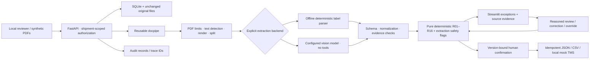

# Architecture and trust boundaries

## Boundaries

- **Documents are data, never instructions.** The model has no tools or cross-shipment retrieval. Model output is not authority to export or change rule severity.
- **Extraction is not validation.** Docpipe preserves evidence and raw/normalized values. R01–R16 make deterministic comparisons; a plausible value is not automatically grounded.
- **Human control is versioned.** Corrections rerun validation and invalidate confirmation. Overrides preserve the original discrepancy and require a reason. Export is blocked until the exact current version is confirmed.
- **Local synthetic sandbox.** SQLite and a local original/render store are the implemented fallback. PostgreSQL/MinIO are architectural targets, not equivalent adapters merely because containers can start. No external TMS or customs endpoint is called.
- **Reference subsets are not authorities.** Unlisted codes require verification; they are not automatically legally invalid. HS checks and dangerous-goods screening are advisory. Road shipments do not inherit ocean-only container/port assumptions.

## Reuse boundary

`src/docpipe` is independent of shipment review and export: PDF processing, schema enforcement, extraction backends, evidence checks and normalization. A future accounting agent can depend on it without importing freight rules. Accounting integration is not implemented in this project.
